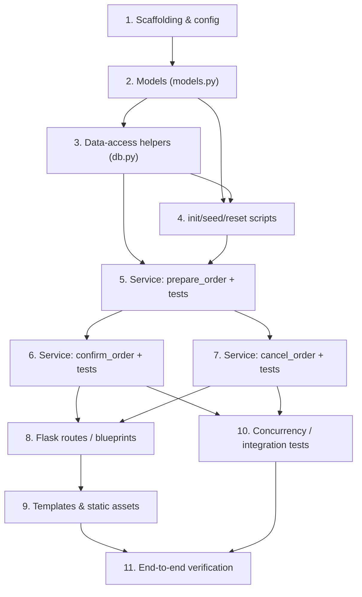

# Implementation Plan: Local Buy and Sell (STS Milestone / Phase 1)

## Overview

This plan converts the approved `design.md` into small, incremental, test-driven coding
tasks in strict dependency order. Each task builds on prior tasks with no orphaned code:
scaffolding first, then models, then no-commit data-access helpers, then explicit DB/seed
scripts, then the trading service (review → execute → cancel) with tests, then Flask routes,
then templates, then concurrency/integration tests, and finally an end-to-end verification task.

Technology (from design): Python 3, Flask with `create_app` app factory, SQLAlchemy ORM,
MySQL via PyMySQL, Jinja templates + CSS + small JS, Hypothesis + pytest for tests, `Decimal`
money mapped to `Numeric(12,2)`. Money is never `float`. The trading service owns the
transaction boundary (commit/rollback); `db.py` helpers never commit. Tests run against a
SEPARATE MySQL test database.

The design document uses Python throughout (not pseudocode), so no implementation-language
selection is needed — all tasks are written for Python 3.

## Task Dependency Graph



```json
{
  "waves": [
    { "id": 0, "tasks": ["1"] },
    { "id": 1, "tasks": ["2"] },
    { "id": 2, "tasks": ["3.1", "3.2", "3.3", "4.1", "4.2", "4.3"] },
    { "id": 3, "tasks": ["5.1"] },
    { "id": 4, "tasks": ["5.2", "5.3"] },
    { "id": 5, "tasks": ["5.4", "5.5", "6.1", "7.1"] },
    { "id": 6, "tasks": ["6.2", "6.3", "6.4", "7.2", "8.1", "8.2"] },
    { "id": 7, "tasks": ["9.1", "9.2", "10.1"] },
    { "id": 8, "tasks": ["11.1"] }
  ]
}
```

Execution order: 1 → 2 → 3 → 4 → 5 → 6 → 7 → 8 → 9 → 10 → 11. Tasks 6 and 7 both build on
task 5; task 10 depends on the service (6, 7); task 11 depends on everything.

## Tasks

- [x] 1. Project scaffolding and configuration
  - Create the `app/` package with `__init__.py` exposing `create_app(config)` app factory that reads config from env vars, registers blueprints, and binds the single SQLAlchemy instance (do NOT reset or re-seed the DB on startup).
  - Create `app/extensions.py` with a single `db = SQLAlchemy()` instance created once and bound inside `create_app`.
  - Create `app/config.py` with `DevConfig` and `TestConfig` classes that read `DATABASE_URL`, `TEST_DATABASE_URL`, and `SECRET_KEY` from env vars; Dev uses the dev DB and Test uses a SEPARATE MySQL test database. Keep the DB connection string fully env-configurable so a later move to AWS RDS needs no code change.
  - Create `requirements.txt` with PINNED versions for Flask, SQLAlchemy, PyMySQL, Hypothesis, pytest, and python-dotenv.
  - Create `.env.example` listing `DATABASE_URL`, `TEST_DATABASE_URL`, and `SECRET_KEY` as variable names with placeholder values only and NO secrets.
  - Create `README.md` with setup (create `sts` and `sts_test` MySQL databases, copy `.env.example` → `.env`, `pip install -r requirements.txt`), run, and test instructions.
  - Create empty `app/services/__init__.py` and `app/routes/__init__.py` so the packages import cleanly.
  - _Requirements: 1.2, 1.3, 8.14, 8.15, 11.4_

- [x] 2. Define database models (`app/models.py`)
  - Define `User` (id, name, email, password_hash, role), `Account` (id, user_id FK, cash_balance, starting_balance), `Stock` (id, company_name, ticker, current_price, available_shares), `Order` (id, account_id FK, stock_id FK, action, quantity, reviewed_price, total, status, created_at, completed_at), `Transaction` (id, order_id FK, account_id FK, stock_id FK, action, quantity, execution_price, total_amount, completed_at), `Position` (id, account_id FK, stock_id FK, quantity), and `EventLog` (id, user_id FK, event_type, description, created_at), with the relationships from the design ERD.
  - Add constraints: unique `Stock.ticker`; unique composite `Position(account_id, stock_id)`; unique `Transaction.order_id`.
  - Model `Order.status` as the enum PENDING / COMPLETED / CANCELLED plus the transient EXECUTING claim state used by the atomic lock in the design.
  - Use `Numeric(12, 2)` for all money columns: `Account.cash_balance`, `Account.starting_balance`, `Stock.current_price`, `Order.reviewed_price`, `Order.total`, `Transaction.execution_price`, `Transaction.total_amount`. Use integer columns for all share quantities. Money is handled as `Decimal` in Python, never `float`.
  - Only create the tables in scope for this milestone (User, Account, Stock, Order, Transaction, Position, EventLog); do NOT create Administrators or Market_Schedule.
  - _Requirements: 1.1, 1.4, 10.5, 10.9, 17.1_

- [x] 3. Implement no-commit data-access helpers (`app/db.py`)
  - [x] 3.1 Implement read/lookup helpers
    - `get_demo_account(session)` resolving the single backend-selected demo account, `get_stock(session, stock_id)`, and `get_position(session, account_id, stock_id)`. Query-only; no commits.
    - _Requirements: 1.2, 1.3, 8.3, 8.4, 8.5, 8.14_

  - [x] 3.2 Implement locking and conditional-claim helpers
    - `get_order_for_update(session, order_id)` using `SELECT ... FOR UPDATE`, and `lock_order_if_pending(session, order_id)` performing an atomic conditional `UPDATE` of status PENDING → claimed using bound parameters only (no f-strings/concat).
    - _Requirements: 8.12, 8.13, 12.1, 12.2, 12.3_

  - [x] 3.3 Implement mutation helpers (add/flush only, never commit)
    - `upsert_position(session, account_id, stock_id, delta)` that creates on first buy, increases/decreases, and deletes the Position when quantity reaches zero; `add_transaction(session, ...)`; `add_event_log(session, ...)`. All helpers only add/flush/query via SQLAlchemy bound parameters; the service owns commit/rollback.
    - _Requirements: 10.3, 10.4, 10.5, 10.9, 10.10, 17.1_

- [x] 4. Database initialization and demo seed scripts (explicit, never on startup)
  - [x] 4.1 Create `scripts/init_db.py`
    - Create the empty schema from the SQLAlchemy models (no data). Document the exact command (`python scripts/init_db.py`).
    - _Requirements: 11.4_

  - [x] 4.2 Create `scripts/seed_demo.py`
    - Insert one trainee `User`, one practice `Account` with `$10,000.00` starting cash; at least three fictional stocks with fixed prices and available shares; DEMO1 at `$50.00`/share with `1,000` available shares; the trainee starts with `0` DEMO1 shares; and a starter `Position` in a different stock so a Sell can be demonstrated immediately. Document the exact command (`python scripts/seed_demo.py`).
    - _Requirements: 1.1, 1.4, 1.5, 1.6, 1.7, 1.8_

  - [x] 4.3 Create `scripts/reset_demo.py`
    - Explicit reset that targets ONLY the demo/test database (never the dev DB implicitly). Document the exact command (`python scripts/reset_demo.py`).
    - _Requirements: 11.4_

- [x] 5. Trading service — review step (`app/services/trading.py`) with tests
  - [x] 5.1 Define typed trade errors
    - Define `TradeError` base (with `.message`) and subclasses `InvalidQuantity` ("Enter a positive whole number."), `NotEnoughMoney` ("Not enough money."), `NotEnoughShares` ("Not enough shares."), `NotEnoughInventory` ("Not enough shares available to buy."), `OrderNotPending` ("This order has already been completed or cancelled."), `PriceUnavailable`, `InvalidTarget`, and `PriceChanged`, each carrying the exact user-facing message. Add `OrderReview` and `TradeResult` plain dataclasses.
    - _Requirements: 9.1, 9.2, 9.3, 9.4, 9.5, 9.6_

  - [x] 5.2 Implement `prepare_order(account_id, stock_id, action, quantity_raw)`
    - Resolve trusted records (demo account, stock, position) from the DB; run all Pre-Execution Checks (Req 8): account/stock existence and ownership (`InvalidTarget`), action is buy or sell, quantity parses to a positive whole number rejecting blank/zero/negative/fractional/nonnumeric (`InvalidQuantity`), DB price `> 0` (`PriceUnavailable`), buy cash check (`NotEnoughMoney`) and inventory check (`NotEnoughInventory`), sell position check (`NotEnoughShares`). On success compute `total = price * quantity`, create exactly ONE PENDING `Order` with `reviewed_price` and `total`, and make no cash/position/inventory change. Flask-free and page-free: plain params in, plain result/exception out.
    - _Requirements: 5.3, 5.4, 6.1, 8.1, 8.3, 8.4, 8.5, 8.6, 8.7, 8.8, 8.9, 8.10, 8.11, 8.14, 8.15, 9.7, 15.1, 15.2, 15.3, 15.4, 15.5, 16.1, 16.2, 16.4, 16.5, 16.6_

  - [x] 5.3 Add test fixtures and separate test DB (`tests/conftest.py`)*
    - Build the test app with `TestConfig`, create the schema in the SEPARATE MySQL test database, and reset state between tests (reset_demo semantics, test DB only). Never touch the dev DB.
    - _Requirements: 11.4_

  - [x] 5.4 Write example tests for `prepare_order`*
    - A valid prepare creates exactly one PENDING order (with `reviewed_price` = DB price) and changes nothing else; each invalid-quantity variant (blank/zero/negative/fractional/nonnumeric); insufficient cash; insufficient inventory; insufficient owned shares; missing stock; missing account; order/stock resolution. Assert on persisted DB state read back from the test DB.
    - _Requirements: 6.1, 8.1, 15.1, 15.2, 15.3, 15.4, 15.5, 16.1, 16.2, 16.4, 16.5, 16.6_

  - [x] 5.5 Write Hypothesis property tests for the review step (min 100 iterations each)*
    - **Property 1: Total equals price times quantity at two decimals** — `# Feature: local-buy-and-sell, Property 1: Total equals price times quantity at two decimals`
    - **Property 2: Preparing a valid order creates exactly one PENDING order and changes nothing else** — `# Feature: local-buy-and-sell, Property 2: Preparing a valid order creates exactly one PENDING order and changes nothing else`
    - **Property 4: Invalid quantities are always rejected** — `# Feature: local-buy-and-sell, Property 4: Invalid quantities are always rejected`
    - **Property 5: A buy never spends more cash than the account holds** — `# Feature: local-buy-and-sell, Property 5: A buy never spends more cash than the account holds`
    - **Property 6: A buy never exceeds available inventory** — `# Feature: local-buy-and-sell, Property 6: A buy never exceeds available inventory`
    - **Property 7: A sell never exceeds the owned position** — `# Feature: local-buy-and-sell, Property 7: A sell never exceeds the owned position`
    - **Validates: Requirements 5.3, 6.1, 8.1, 8.7, 8.9, 8.10, 8.11, 15.1, 15.2, 15.3, 15.4, 15.5, 16.4, 16.5, 16.6_

- [x] 6. Trading service — execute/confirm step with tests
  - [x] 6.1 Implement `confirm_order(account_id, order_id)`
    - Atomically claim the order via conditional `UPDATE ... WHERE status='PENDING'` (bound params); if zero rows change raise `OrderNotPending` (idempotency / competing requests). Re-read trusted values with `SELECT ... FOR UPDATE` on account/stock/position and re-run all Pre-Execution Checks. Verify `reviewed_price` still equals the current DB price, else raise `PriceChanged` and leave the order PENDING. On success apply ALL changes in ONE transaction: cash (buy `-=` / sell `+=` total), Position create/increase (buy) or decrease/delete-at-zero (sell), Stock inventory subtract (buy) / return (sell), Order → COMPLETED with `completed_at`, exactly one `Transaction`, exactly one `EventLog`, then `commit()`. On ANY failure `rollback()` and leave the order PENDING (except invalid-status cases, which stay rejected).
    - _Requirements: 8.2, 8.16, 10.1, 10.2, 10.3, 10.4, 10.5, 10.6, 10.7, 10.8, 10.9, 10.10, 10.11, 10.12, 10.13, 12.1, 12.2, 12.3, 17.4_

  - [x] 6.2 Write exact milestone BUY and SELL example tests*
    - BUY: 5 DEMO1 @ $50 from $10,000 → cash `9750.00`, DEMO1 position `5`, inventory `995`, order COMPLETED, exactly one Transaction + one EventLog. SELL: 2 DEMO1 @ $50 while owning 5 and cash `9750.00` → cash `9850.00`, position `3`, inventory `997`, COMPLETED, one Transaction + one EventLog. Assert on values read back from the test DB.
    - _Requirements: 13.1, 13.2, 13.3, 13.4, 13.5, 14.1, 14.2, 14.3, 14.4, 14.5_

  - [x] 6.3 Write execute edge-case example tests*
    - Sell entire holding removes the Position row; repeated confirmation executes at most once (second rejected with the exact message); price-changed requires re-review and leaves order PENDING; a forced mid-trade DB error rolls back every change (DB state identical to pre-execution, order stays PENDING, no Transaction, no EventLog); cancelled/failed orders produce no Transaction.
    - _Requirements: 8.16, 10.12, 10.13, 12.1, 12.3, 17.1, 17.2, 17.4_

  - [x] 6.4 Write Hypothesis property tests for the execute step (min 100 iterations each)*
    - **Property 9: A confirmed trade applies the correct deltas and conserves shares** — `# Feature: local-buy-and-sell, Property 9: A confirmed trade applies the correct deltas and conserves shares`
    - **Property 10: A completed trade produces exactly one transaction and one event log, all atomically** — `# Feature: local-buy-and-sell, Property 10: A completed trade produces exactly one transaction and one event log, all atomically`
    - **Property 11: Any failure during execution rolls back every change** — `# Feature: local-buy-and-sell, Property 11: Any failure during execution rolls back every change`
    - **Property 12: Confirmation is idempotent** — `# Feature: local-buy-and-sell, Property 12: Confirmation is idempotent`
    - **Property 13: A cancelled or failed order yields no completed-trade transaction** — `# Feature: local-buy-and-sell, Property 13: A cancelled or failed order yields no completed-trade transaction`
    - **Property 14: Stored money always has two decimal places** — `# Feature: local-buy-and-sell, Property 14: Stored money always has two decimal places`
    - Also cover **Property 8** (price changed between review and confirm blocks execution) here: `# Feature: local-buy-and-sell, Property 8: Confirmation requires the reviewed price to still match the database price`
    - **Validates: Requirements 8.16, 10.1, 10.2, 10.3, 10.4, 10.6, 10.7, 10.8, 10.9, 10.10, 10.11, 10.12, 10.13, 11.2, 12.1, 12.3, 17.2, 17.4_

- [x] 7. Trading service — cancel step with tests
  - [x] 7.1 Implement `cancel_order(account_id, order_id)`
    - Verify the order belongs to the demo account and is PENDING, set it CANCELLED, and commit. Make no cash/position/inventory/transaction change. Reject non-PENDING orders (`OrderNotPending`).
    - _Requirements: 7.1, 7.2, 7.3, 7.4, 7.5_

  - [x] 7.2 Write cancel tests*
    - Cancelling a PENDING order sets status CANCELLED and leaves cash, positions, inventory, and transactions unchanged (assert on test DB); non-PENDING orders are rejected. Add Hypothesis property test: `# Feature: local-buy-and-sell, Property 3: Cancelling a pending order changes no balances` (min 100 iterations).
    - **Validates: Requirements 7.1, 7.3, 7.4_

- [x] 8. Flask routes and blueprints
  - [x] 8.1 Implement GET routes (`app/routes/main.py`)
    - Dashboard (account id, cash balance, holdings), stock list (company, ticker, price, available shares), and stock details (name, ticker, price, shares owned, buy form + sell form). All values read from the database; GET never changes data. The backend selects the demo identity and ignores any browser-supplied user/account id.
    - _Requirements: 1.2, 1.3, 2.1, 2.2, 2.3, 2.4, 3.1, 3.2, 4.1, 4.2, 4.3, 5.6_

  - [x] 8.2 Implement order POST/confirmation routes (`app/routes/orders.py`)
    - `POST /orders/review` calls `prepare_order` and renders the review page from the PENDING order; `POST /orders/<id>/confirm` calls `confirm_order` and redirects (Post/Redirect/Get) to the confirmation GET; `POST /orders/<id>/cancel` calls `cancel_order` and redirects to stock details; `GET /orders/<id>/confirmation` shows the actual saved values from the DB. On any failed check re-render the form preserving the submitted input and showing the exact message. POST is used for all record-changing actions.
    - _Requirements: 5.5, 6.2, 6.3, 6.4, 6.5, 6.6, 6.7, 6.8, 7.2, 9.1, 9.7, 11.1, 11.2, 11.3, 16.3_

- [x] 9. Templates and static assets
  - [x] 9.1 Create page templates
    - `base.html`, `dashboard.html`, `stock_list.html`, `stock_details.html` (buy form + sell form), `order_review.html` (company + ticker, action, shares, price per share, total cost or proceeds, expected cash after, Confirm + Cancel controls), and `confirmation.html` (completed trade + actual saved balances read from the DB). Use the SAD wireframes as the visual guide and add the missing buy controls and review/confirmation pages.
    - _Requirements: 2.1, 2.2, 2.3, 3.1, 4.1, 4.2, 4.3, 6.2, 6.3, 6.4, 6.5, 6.6, 6.7, 6.8, 11.1, 11.2_

  - [x] 9.2 Create static assets
    - `app/static/style.css` with simple, consistent styling and `app/static/app.js` with small helpers (e.g., disable the Confirm button after click to reduce double submission).
    - _Requirements: 6.8, 12.1_

- [x] 10. Concurrency and integration tests (against the separate test DB)
  - [x] 10.1 Write concurrency and persistence tests (`tests/test_concurrency.py`)*
    - Competing confirmations for the same order keep cash, positions, and inventory correct with only one winner; a refresh (GET) on the confirmation page does not re-execute the trade; saved results are correct after a fresh app context / simulated restart. Assert on values read back from the test DB. Tag the relevant properties, e.g. `# Feature: local-buy-and-sell, Property 12: Confirmation is idempotent`.
    - **Validates: Requirements 11.3, 11.4, 12.1, 12.2, 12.3, 17.2, 17.3, 17.5_

- [x] 11. End-to-end verification (manual + automated checklist and final report)
  - [x] 11.1 Run the full verification pass and produce the report
    - Initialize and seed a fresh demo DB (`python scripts/init_db.py`, `python scripts/seed_demo.py`); run the automated test suite against the SEPARATE test DB (`pytest`); exercise buy and sell through the web pages; run the two exact scenarios (buy 5 DEMO1, sell 2 DEMO1); the invalid-quantity set (blank/zero/negative/fractional/nonnumeric); missing records, another account's order, insufficient cash, insufficient inventory, overselling; cancel of a PENDING order, sell entire holding, repeated confirmation, refresh of the result page; competing requests; forced mid-trade DB error → rollback. Verify DB values before and after (not just screen messages). Review `app/db.py` for any string-built SQL and confirm all queries use bound parameters. Confirm saved results survive an application restart. Produce the final report: setup/run commands, actual test results, DB evidence for the successful buy and sell, remaining problems with effects and suggested fixes, and a short demo walkthrough split into setup/database, buying, and selling.
    - _Requirements: 8.14, 8.15, 11.3, 11.4, 12.1, 12.2, 12.3, 13.1, 13.2, 13.3, 13.4, 13.5, 14.1, 14.2, 14.3, 14.4, 14.5, 16.1, 16.2, 16.3, 16.4, 16.5, 16.6, 17.1, 17.2, 17.3, 17.4, 17.5_

## Notes

- Tasks marked with `*` are optional test sub-tasks and may be skipped for a faster MVP; core implementation sub-tasks are never optional. A coding agent MUST implement non-`*` sub-tasks and MUST NOT implement `*` sub-tasks unless asked.
- Each task references specific requirement clauses for traceability, and test tasks reference the design Correctness Properties they validate.
- `db.py` helpers never commit; the trading service owns the single transaction boundary so every completed trade commits or rolls back as a whole.
- Money is always `Decimal` mapped to `Numeric(12,2)`; never `float`.
- All tests run against a SEPARATE MySQL test database; the dev DB is never touched by tests.
- Deployment and AWS/RDS provisioning are deferred and intentionally excluded from this plan.
